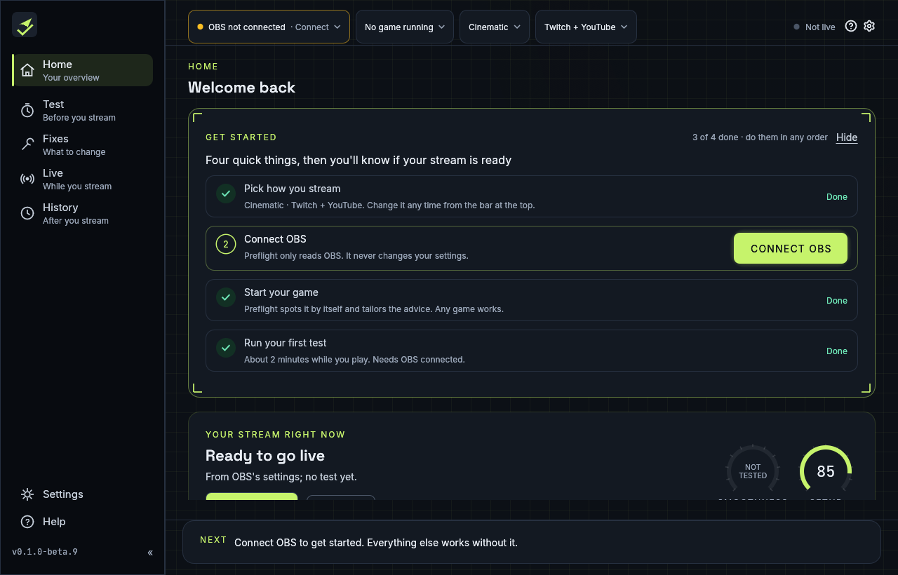
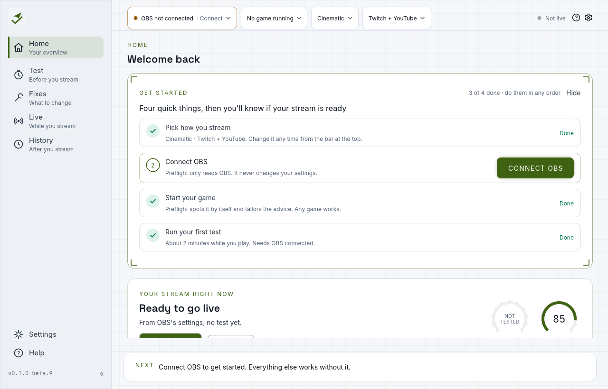

# Stream Preflight

Check your game, OBS and stream before you go live.

Stream Preflight watches a short test while you play, then tells you the one thing to change next: in your game, in OBS, or on your PC. It reads settings and measures; it never changes anything for you.

Linux (Windows builds are paused for now). Free, no account, no ads, no analytics.

| Dark | Light |
|---|---|
|  |  |

Dark or light follows your desktop; change it in **Settings › Appearance**.

## Install (Linux)

One line. It downloads the newest version from GitHub Releases, checks it, installs it for you (no sudo) and adds it to your app menu:

```sh
curl -fsSL https://raw.githubusercontent.com/Matt-B-007/Stream-Preflight/main/install.sh | sh
```

Options go after `sh -s --`, for example `... | sh -s -- --beta`:

| Option | What it does |
|---|---|
| `--beta` | The newest beta, even when there's a stable version (while there are only betas, you get the newest beta anyway) |
| `--version 0.1.0-beta.8` | A specific version |
| `--no-launch` | Don't start Stream Preflight afterwards |
| `--from-source` | Build it with cargo instead of downloading the program |
| `--uninstall` | Remove it (add `--delete-settings` to remove settings and history too) |

The installer checks the program against `SHA256SUMS`, and checks that file's signature when `minisign` is installed (`sudo pacman -S minisign`). 64-bit Linux, glibc 2.30 or newer. Run the line again any time to reinstall.

Windows builds are paused for now; the Windows code stays in the project.

## Updates

Stream Preflight checks GitHub's public list of releases once a day (you can turn that off in **Settings › Updates**). When there's a newer version, an **Update** button appears top right; it shows what's new, with **Update now**, **Later** and **Skip this version**. Before anything is replaced:

1. The download must match `SHA256SUMS`.
2. `SHA256SUMS` must carry a valid signature from the maintainer's key (the app has a main key and an offline backup key built in, and accepts either).
3. The new version must pass its own quick self-test.

If any of these fails, nothing changes. A release that doesn't have its signature yet counts as "not ready yet". Your settings always stay.

- **Restart when you're ready**: after it installs, Preflight asks you to restart; it doesn't restart by itself.
- **Go back**: the version you had before is kept. **Settings › Updates › Go back** (or `stream-preflight --rollback`) puts it back.
- **Betas** are named after the next version: `v0.1.0-beta.8` comes before `v0.1.0`. Beta builds look for betas automatically; the **Stable / Beta** switch in **Settings › Updates** changes that.
- **Switch back to stable** installs the latest stable version, even if it's older than your beta.
- Installed with a package manager (in `/usr` or `/opt`)? Update with the package manager instead, for example `paru -Syu`.

Versions up to beta.7 update from the repository's `download/` folder. beta.8 is published there one last time so they can reach it; after that, every update comes from GitHub Releases.

## Command line

| Command | What it does |
|---|---|
| `stream-preflight --version` | Prints the version |
| `stream-preflight --self-test` | Checks that the program and its files are in order (`--quick` for the short version) |
| `stream-preflight --report` | Saves a bug report (same privacy rules as the app) and prints where |
| `stream-preflight --update` | Installs the newest version, with the same checks as **Update now** |
| `stream-preflight --rollback` | Goes back to the version you had before the last update |
| `stream-preflight --uninstall` | Removes the program and its menu entry, keeping settings (`--delete-settings` removes those too). Asks first; `--yes` skips the question |
| `stream-preflight --help` | Lists these options |

Only one window opens at a time: starting Stream Preflight again brings the open window to the front.

### OBS setup

In OBS: **Tools › WebSocket Server Settings › Enable WebSocket server**. Copy the password into Preflight when it asks. Preflight only reads OBS; it never starts, stops or changes anything there.

## What it does

- **Home**: a Get started card you can do in any order (nothing is locked), then one plain answer, your top fixes, last test and last stream. A bar at the top shows OBS, your game, style and platforms, each one click from changing.
- **Test**: play while OBS records (or streams and records). Preflight measures your GPU, CPU, encoder, skipped and dropped frames, and audio levels. A checklist ticks itself as OBS starts.
- **Fixes**: one change at a time, ordered by your style (Competitive, Balanced or Cinematic). Each fix says exactly where the setting is and notices when you've changed it. **Your setup** (from Home) shows OBS, game and PC settings side by side.
- **Live**: bitrate, dropped and skipped frames, each output and your recording, while you stream.
- **History**: a summary after each stream (bitrate, dropped frames, what caused them and your recording), and everything you tested and changed.
- **Games**: profiles for popular games, plus an automatic reader for Unity, Unreal, Source and Godot games from Steam, Heroic, Lutris, Bottles, Epic and Game Pass, and Minecraft from any launcher.
- **Several platforms**: Twitch, YouTube and Kick, through OBS plugins or a restream service.
- **Two PCs**: connect to OBS on your streaming PC, with capture card checks (frame rate, resolution, colour range, MJPEG, HDR, refresh rate judder). **Paired mode** links Preflight on both PCs with a 6-digit code over your home network.
- **System tray**: the icon shows OBS not connected, ready, things to fix, testing or live, with notifications when a test finishes or a stream ends. **Start at login** (off by default) and **start in the tray**. On KDE and GNOME Wayland, where a window can't hide itself, a small tray-only Preflight keeps watching OBS and opens the window when you click the icon.
- **Light while you game**: no redrawing while minimized or in the tray, and at most once a second while the game is in front. Help shows Preflight's own processor and memory use.
- **Updates**: signed GitHub Releases, checked against a checksum and the maintainer's signature, and self-tested before they go in place. The previous version is kept so you can go back.

## Keyboard

| Keys | What it does |
|---|---|
| Ctrl+K | Search for a page or command |
| Ctrl+, | Settings |
| ? | All shortcuts |
| Ctrl+Q | Quit |
| Ctrl+Enter | The Next step shown at the bottom |
| Alt+1 … Alt+5 | Home, Test, Fixes, Live, History |
| Ctrl+B | Fold the sidebar to icons |

Help, What's new, the tour and Report a problem are in the **?** menu, top right.

## Where Preflight keeps its files

| What | Where (Linux) |
|---|---|
| Settings, plus up to 5 automatic backups | `~/.config/stream-preflight` |
| History, past streams, preview frames, reports, the version kept for Go back | `~/.local/share/stream-preflight` |
| Logs (1 MB per file, 3 kept) and crash notes | `~/.local/state/stream-preflight` |
| The program | `~/.local/bin/stream-preflight` |

Versions up to beta.8 used `~/.config/streampreflight` and `~/.local/share/streampreflight`; they're moved automatically, and the old names become links so an older version still finds your settings. Preflight keeps its data in `~/.local/share` rather than `~/.cache` because history is worth keeping. Installs from a package manager put the program in `/usr/bin`.

## Privacy

- Nothing is sent anywhere automatically, and there's no analytics.
- The only automatic network use: an optional daily update check (reads GitHub's public list of this project's releases), and an optional upload speed test during scans. If your PC's DNS can't find GitHub, the update check asks Cloudflare, then Google, for GitHub's address (only the name `api.github.com` is sent); **Settings › Updates** turns that off. Both can be turned off in Settings.
- Never collected: stream keys, passwords, tokens, account names, emails, chat, audio, video, IP or MAC addresses, Wi-Fi names, serial numbers or product keys.
- Bug reports are saved on your PC for you to look at first, and **Report a problem** shows exactly what's in them. Home folders (`~`), user and PC names (`<user>`, `<host>`), Steam IDs (`<steamid>`), IP and MAC addresses (`<ip>`, `<mac>`), keys and tokens (`<secret>`), player names, and OBS scene and source names are removed. Reports and logs delete themselves after 14 days.
- The OBS password is encrypted with Windows' data protection on Windows, and stored in a file only you can read on Linux.
- Paired mode talks only to computers on your home network, and only after you've typed the code.

## Safe by design

- Read-only: it never edits game or OBS settings. The only files it deletes are its own test recordings (when you choose to) and, when you uninstall, its own files.
- Anti-cheat friendly: no game memory access, no injection, no hooks.
- Never controls OBS.

## Building from source

Uses the Rust version pinned in `rust-toolchain.toml` (rustup installs it). Before uploading, run `sh scripts/check.sh`: it runs exactly what CI runs (formatting, clippy, build, tests, the program's self-test, dependency licences, shell scripts and GitHub's YAML files). It needs rustup, cargo-deny, shellcheck and PyYAML, and lists anything missing with the install command; on Arch or CachyOS: `sudo pacman -S --needed rustup cargo-deny shellcheck python-yaml`, then `rustup toolchain install` in the project folder. Exit code 0 = passed, 1 = a check failed, 3 = only tools missing. The window code lives in `src/app/`, one file per screen (`home.rs`, `test.rs`, `fixes.rs`, `results.rs`, `live.rs`, `history_page.rs`, `settings.rs`, `help.rs`, `setup.rs`) plus `state.rs` (data and background work), `shell.rs` (sidebar, top bar, Next bar, banners, update dialog), `flow.rs` (shortcuts, command search, What's new, tour), `undo.rs`, `tray.rs`, `pcs.rs` and `widgets.rs`. All colours are in `src/theme.rs`; fonts and their licences are in `assets/fonts`, and `tools/lucide-subset.py` rebuilds the icon font.

```sh
cargo build --release
cargo test
```

Linux release builds use `cargo zigbuild --release --target x86_64-unknown-linux-gnu.2.31` for compatibility with older distributions.

See [CONTRIBUTING.md](CONTRIBUTING.md) for how changes are made and [RELEASING.md](RELEASING.md) for how versions are published.

## Uninstall

**Settings › About & uninstall › Uninstall** removes the program and its menu entry. Your settings and logs stay unless you tick **Also delete my settings and logs**. From a terminal: `stream-preflight --uninstall`, or the install line with `-s -- --uninstall`. On Windows you can also uninstall from **Settings › Apps**. OBS and your games are never touched.

## Help and security

- Questions and problems: [SUPPORT.md](SUPPORT.md).
- Security problems: please report them privately, as [SECURITY.md](SECURITY.md) explains.

## Licence

Stream Preflight is free software under the GNU General Public License, version 3 or (at your option) any later version. See [LICENSE](LICENSE).
